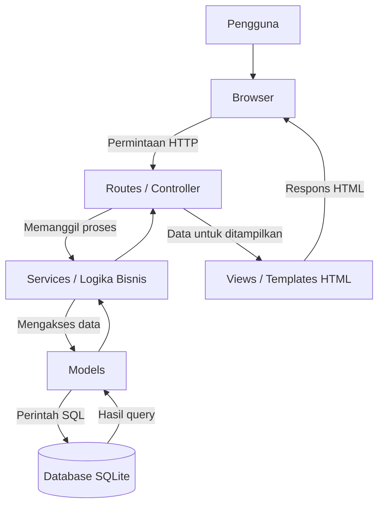

# ARSITEKTUR SISTEM

## Sistem Informasi Laundry Koin

### 1. Pendahuluan

Dokumen ini menjelaskan rancangan arsitektur Sistem Informasi Laundry Koin. Arsitektur dirancang menggunakan pendekatan berlapis (layered architecture) agar setiap bagian aplikasi memiliki tanggung jawab yang jelas, mudah dikembangkan, dan mudah dipelihara.

Teknologi yang digunakan adalah Python dengan framework Flask dan database SQLite. Sistem dirancang untuk mengelola data pengguna, layanan, pelanggan, transaksi, dan informasi mesin.

### 2. Diagram Arsitektur Sistem

Arsitektur sistem terdiri dari beberapa lapisan, yaitu pengguna, browser, Routes/Controller, Services/Logika Bisnis, Models, Database SQLite, dan Views.



**Penjelasan komponen:**

1. **Pengguna:** Orang yang menggunakan sistem melalui browser.
2. **Browser:** Media untuk mengakses aplikasi dan menampilkan halaman sistem.
3. **Routes/Controller:** Menerima permintaan pengguna dan menentukan proses yang harus dijalankan.
4. **Services/Logika Bisnis:** Menjalankan aturan bisnis dan validasi data.
5. **Models:** Mengelola operasi pengambilan, penyimpanan, perubahan, dan penghapusan data.
6. **Database SQLite:** Menyimpan seluruh data yang digunakan aplikasi.
7. **Views:** Menampilkan informasi kepada pengguna melalui halaman HTML.

### 3. Struktur Folder dan Tanggung Jawab

Struktur folder target proyek dirancang sebagai berikut:

```text
rpl-laundry-koin/
|
|-- app.py
|-- models.py
|-- aturan-proyek.md
|-- PRD.md
|-- README.md
|
|-- routes/
|   |-- __init__.py
|   |-- auth_routes.py
|   |-- layanan_routes.py
|   |-- pelanggan_routes.py
|   |-- transaksi_routes.py
|   |-- laporan_routes.py
|
|-- services/
|   |-- auth_service.py
|   |-- layanan_service.py
|   |-- pelanggan_service.py
|   |-- transaksi_service.py
|   |-- laporan_service.py
|
|-- templates/
|   |-- base.html
|   |-- auth/
|   |-- layanan/
|   |-- pelanggan/
|   |-- transaksi/
|   |-- laporan/
|
|-- static/
|   |-- css/
|   |-- js/
|   |-- images/
|
|-- instance/
|   |-- laundry_koin.db
|
|-- tests/
|   |-- cek_skema.py
|   |-- test_models.py
|   |-- test_routes.py
|   |-- test_services.py
|
|-- docs/
    |-- desain/
    |-- elisitasi/
    |-- pengujian/
    |-- uml/
```

**Tanggung jawab setiap file dan folder:**

| File/Folder | Tanggung Jawab |
|---|---|
| `app.py` | Membuat, mengatur, dan menjalankan aplikasi Flask. |
| `models.py` | Mengelola koneksi dan seluruh operasi database SQLite. |
| `routes/` | Menangani URL dan permintaan dari pengguna. |
| `__init__.py` | Menginisialisasi package routes. |
| `auth_routes.py` | Menangani permintaan terkait login dan autentikasi. |
| `layanan_routes.py` | Menangani permintaan pengelolaan layanan. |
| `pelanggan_routes.py` | Menangani permintaan pengelolaan pelanggan. |
| `transaksi_routes.py` | Menangani permintaan pencatatan dan pengelolaan transaksi. |
| `laporan_routes.py` | Menangani permintaan laporan. |
| `services/` | Menyimpan logika bisnis dan validasi proses aplikasi. |
| `templates/` | Menyimpan halaman HTML yang ditampilkan kepada pengguna. |
| `static/` | Menyimpan file CSS, JavaScript, dan gambar. |
| `instance/` | Menyimpan file database SQLite aplikasi. |
| `tests/` | Menyimpan file pengujian aplikasi. |
| `docs/` | Menyimpan dokumentasi pengembangan proyek. |

Struktur tersebut merupakan rancangan target. Pembuatan folder dan file aplikasi dilakukan secara bertahap sesuai kebutuhan pengembangan.

### 4. Alur Komunikasi Antarbagian Sistem

Alur komunikasi antarbagian sistem adalah sebagai berikut:

1. Pengguna membuka aplikasi melalui browser.
2. Browser mengirimkan permintaan kepada Routes/Controller.
3. Routes meneruskan proses kepada Services sesuai kebutuhan.
4. Services menjalankan logika bisnis dan melakukan validasi.
5. Jika membutuhkan data, Services memanggil fungsi yang tersedia pada Models.
6. Models menjalankan operasi database SQLite dan mengembalikan hasilnya.
7. Services mengolah hasil proses dan mengembalikannya kepada Routes.
8. Routes meneruskan data ke Views untuk ditampilkan.
9. Browser menampilkan hasil kepada pengguna.

Setiap bagian berkomunikasi sesuai tanggung jawabnya agar proses aplikasi terorganisasi dengan baik.

### 5. Aturan Akses Database

Untuk menjaga konsistensi pengelolaan data, ditetapkan aturan berikut:

1. Hanya file `models.py` yang diperbolehkan mengakses database SQLite secara langsung.
2. Routes tidak diperbolehkan membuka koneksi database atau menjalankan perintah SQL.
3. Services tidak diperbolehkan membuka koneksi database atau menjalankan perintah SQL secara langsung.
4. Views hanya bertugas menampilkan data dan tidak boleh mengakses database.
5. Seluruh operasi CRUD (Create, Read, Update, Delete) harus dilakukan melalui fungsi pada `models.py`.
6. Koneksi SQLite harus mengaktifkan foreign key agar hubungan antartabel tetap terjaga.

Aturan ini diterapkan agar pengelolaan database terpusat dan perubahan pada database lebih mudah dikendalikan.

### 6. Urutan Pengembangan Modul Sprint 1

Berdasarkan SRS dan Product Backlog, pengembangan Sprint 1 diprioritaskan pada tiga kebutuhan fungsional yang termasuk kategori Must Have, yaitu login pengguna, pengelolaan layanan dan harga, serta pengelolaan data pelanggan.

Urutan pengembangan modul yang direncanakan adalah:

| Urutan | ID Kebutuhan | Modul | Alasan |
|---|---|---|---|
| 1 | KF-01 | Login pengguna | Menjadi dasar autentikasi pengguna sebelum mengakses sistem. |
| 2 | KF-07 | Pengelolaan layanan dan harga | Menyediakan data layanan dan harga yang dibutuhkan dalam proses transaksi. |
| 3 | KF-08 | Pengelolaan data pelanggan | Menyediakan data pelanggan yang dibutuhkan dalam pencatatan transaksi. |

Pengembangan dilakukan secara bertahap agar setiap modul dapat mendukung proses pengembangan modul berikutnya.

### 7. Kesimpulan

Arsitektur Sistem Informasi Laundry Koin dirancang menggunakan pendekatan berlapis dengan pembagian tanggung jawab antara Routes, Services, Models, Database, dan Views.

Penggunaan arsitektur ini diharapkan dapat mempermudah proses pengembangan, pemeliharaan, pengujian, serta pengelolaan data. Urutan pengembangan modul Sprint 1 mengikuti prioritas dan kebutuhan yang telah ditetapkan dalam Product Backlog.