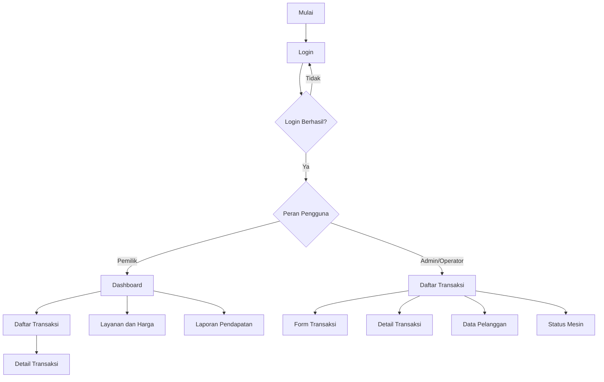

# PETA NAVIGASI

## Sistem Informasi Laundry Koin

### 1. Pendahuluan

Peta navigasi menggambarkan hubungan antarhalaman dan alur perpindahan pengguna dalam Sistem Informasi Laundry Koin.

### 2. Struktur Navigasi

#### A. Navigasi Pemilik

- Dashboard
- Daftar Transaksi
  - Detail Transaksi
- Layanan dan Harga
- Laporan Pendapatan

#### B. Navigasi Admin/Operator

- Daftar Transaksi
  - Form Transaksi
  - Detail Transaksi
- Data Pelanggan
- Status Mesin

### 3. Diagram Peta Navigasi

### 4. Aturan Navigasi

1. Pengguna harus login sebelum mengakses sistem.
2. Sistem memeriksa peran pengguna setelah login.
3. Pemilik diarahkan ke Dashboard.
4. Admin/Operator diarahkan ke Daftar Transaksi.
5. Menu ditampilkan sesuai hak akses pengguna.
6. Pengguna dapat kembali ke halaman sebelumnya.
7. Pengguna dapat keluar melalui fitur Logout.

### 5. Catatan

1. Dashboard merupakan halaman utama Pemilik.
2. Pengelolaan layanan dan harga dilakukan oleh Pemilik.
3. Form transaksi digunakan Admin/Operator.
4. Akses pelanggan terhadap halaman Layanan dan Harga masih perlu dikonfirmasi.
5. Logout merupakan tindakan, bukan halaman utama tersendiri.

### 6. Kesimpulan

Peta navigasi membagi alur penggunaan sistem berdasarkan peran Pemilik dan Admin/Operator agar setiap pengguna dapat mengakses fitur sesuai hak aksesnya.
